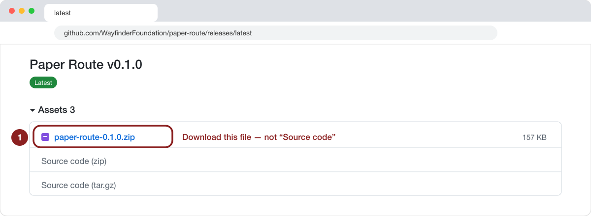
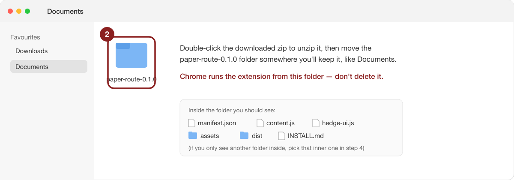
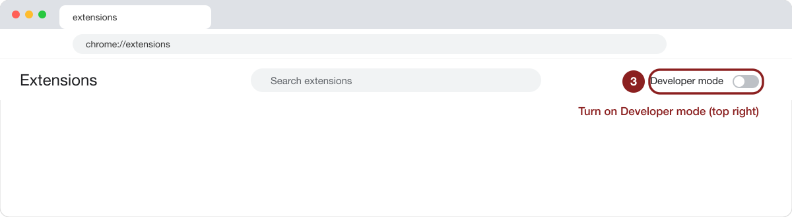
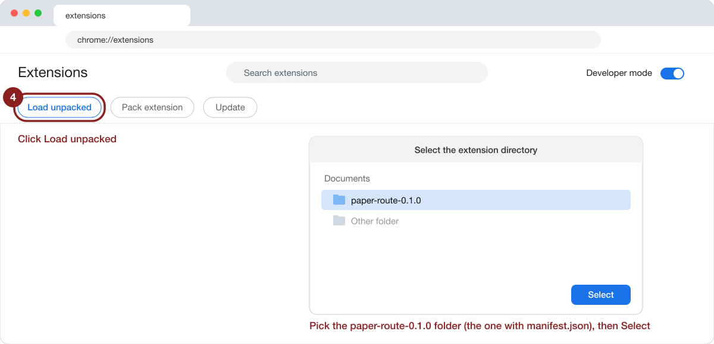
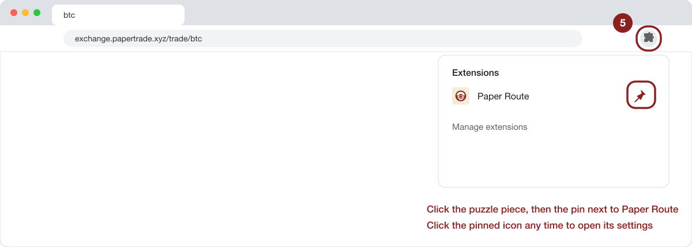
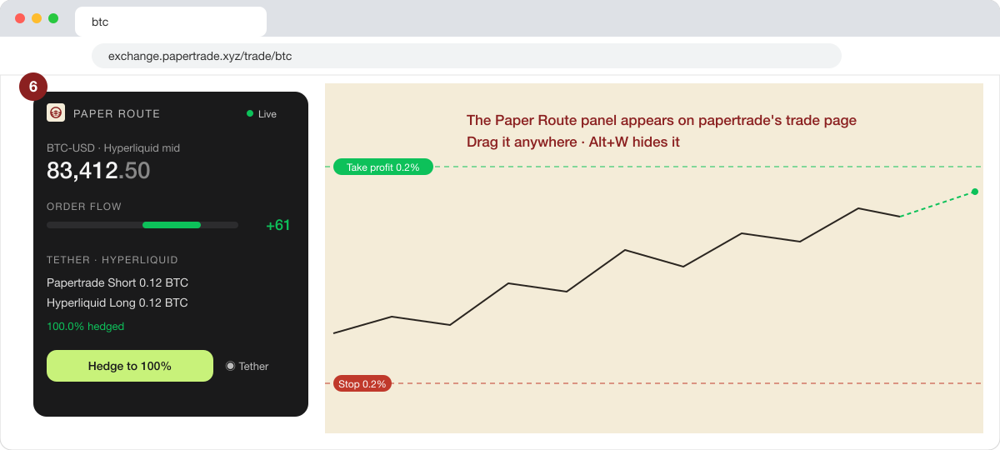

<p align="center"></p>

<h1 align="center">Paper Route</h1>

<p align="center">Delta-neutral hedging for <a href="https://exchange.papertrade.xyz">papertrade</a> on <a href="https://app.hyperliquid.xyz">Hyperliquid</a>, in a Chrome extension. By <a href="https://wayfinder.ai">Wayfinder</a>.</p>

- **Tether**: holds the opposite position on Hyperliquid for exactly as long as your papertrade position exists.
  It follows papertrade's *fills*, not your clicks, so queued orders never leave you one-sided.
- **Safety net**: if papertrade liquidates you while your browser is closed, Hyperliquid closes the hedge at the
  same price.
- **Stop loss and take profit** on papertrade, which has neither: set them in the order form or on any open
  position, by price, % return or $.
- **Order-flow overlay**: a live read of Hyperliquid's order book and trades, drawn on papertrade's chart.

BTC and ETH. Everything runs in your browser; there's no Paper Route server.

> Papertrade and Hyperliquid are separate venues with real money on both. Nothing here is financial advice.
> Read [Risks](#risks) before you turn anything on.

## Install

Paper Route isn't on the Chrome Web Store yet, so you load it into Chrome yourself. It takes about two minutes.

**1. Download the extension.** Open the [latest release](../../releases/latest) and download
`paper-route-<version>.zip` from **Assets**. Don't use the "Source code" downloads.



**2. Unzip it and keep the folder.** Double-click the zip, then move the `paper-route-<version>` folder somewhere
you'll keep it, such as Documents. Chrome runs the extension from this folder, so don't delete it.



**3. Turn on Developer mode.** Open `chrome://extensions` (paste it into the address bar) and switch on
**Developer mode** in the top-right corner.



**4. Load the folder.** Click **Load unpacked** (top-left), choose the `paper-route-<version>` folder, the one that
contains `manifest.json`, and click **Select**. Paper Route appears in your extensions list, switched on.



**5. Pin it.** Click the puzzle-piece icon in Chrome's toolbar, then the pin next to Paper Route. Clicking the
pinned icon opens Paper Route's settings.



**6. Open papertrade.** Go to [papertrade](https://exchange.papertrade.xyz/trade/btc) and sign in. The Paper Route
panel appears on the trade page; drag it anywhere, collapse it, or hide it with **Alt+W**.



## Set up hedging

Click the Paper Route toolbar icon to open its settings, then **1 · Connect Hyperliquid**:

1. Paste the private key of the Hyperliquid wallet you'll hedge with (or pick **Wayfinder API key** and add its
   wallet address).
2. Click **Connect**.

That's it. Paper Route works out the wallet from the key and uses the key once to approve a **trading key** on
your Hyperliquid account (an API wallet that can place orders but **can't withdraw or transfer**), plus the
builder fee. Then it forgets your key: nothing that can withdraw is saved. You'll only paste the key again to
send USDC from Hyperliquid to papertrade, or to reconnect after 180 days. Your papertrade account is picked up
from the one you're signed in to on papertrade. The two can be the same wallet.

Back on papertrade, pick the Hyperliquid leverage in the panel, then turn on **Tether** (connecting turns it on for you).
If a trade is too small for papertrade's minimum, the panel says what to change (usually a higher Hyperliquid
leverage, or more USDC).

The market follows the papertrade page: `/trade/btc` hedges BTC, `/trade/eth` hedges ETH. While Tether is
holding an open position, Paper Route stays on that coin until it's flat.

## Keep it running

Tether, stop losses and take profits run **in your browser**. While any of them is active:

- **Keep Chrome open and Paper Route enabled.** The toolbar icon shows **ON** and the panel shows an amber banner
  while Paper Route is responsible for positions.
- **Tether works without the papertrade tab** as long as Chrome is open: it watches papertrade's account and your
  Hyperliquid account from the extension's background.
- **If Chrome is closed, the laptop sleeps or the extension is off, nothing is watched.** Both legs stay open, so
  you remain hedged, but nothing rebalances. If papertrade liquidates the position meanwhile, the
  [safety net](#safety-net) closes the hedge on Hyperliquid at the same price.

## Update

1. Download the new release zip and unzip it. Replacing the old folder is tidiest.
2. In `chrome://extensions`, click the reload icon on Paper Route. If you unzipped to a new folder, remove the old
   copy and **Load unpacked** the new one instead.
3. Refresh papertrade.

The extension ID is fixed, so your encrypted key, trading key, settings and saved trades carry over either way.
Don't load two versions at once.

## Features in detail

### Tether

Papertrade takes a fee on winning trades and none on losses, so the leg you hold there is the one you'd rather
lose with. Paper Route holds the opposite position on Hyperliquid, so the pair is market-neutral. Papertrade
**queues** opens and closes, sometimes for minutes, so the hedge reacts to papertrade **fills**, never to clicks:

- a queued papertrade open is not a position yet, so Hyperliquid waits for it to land;
- a queued papertrade close keeps you exposed, so the Hyperliquid leg stays on until the close fills;
- if the hedge drifts by more than your band (e.g. you trade papertrade by hand), it trues it up.

### Stop loss and take profit

Papertrade has no stop or take-profit orders, so Paper Route adds them where you'd expect:

- **In the order form:** tick **TP / SL** under Bust Price. Each side has a price box and a gain/loss box
  (% return on margin, or $), linked so typing one fills in the other, plus quick picks. The levels attach to the
  position when papertrade fills the order; % and $ targets are worked out from the actual fill price.
- **On any open position:** the **TP/SL** chip on the row opens an editor for that position. Each position has
  its own levels, and they're drawn on the chart.

These levels are **not placed on papertrade**. Paper Route watches Hyperliquid's mid (which papertrade tracks to
under 1 bp) and, when a level is hit, clicks papertrade's own Close button, following papertrade's queue. With
Tether on, the Hyperliquid hedge closes when that close fills. A level is a trigger, not a price guarantee, and it
only works while Chrome is open with Paper Route enabled (see [Keep it running](#keep-it-running)).

### Safety net

Papertrade liquidates a position by itself, browser or not. So that the hedge doesn't outlive it, Paper Route
rests one reduce-only trigger order on Hyperliquid per hedged papertrade position, at that position's liquidation
(bust) price and for its size. If papertrade busts while Chrome is closed, Hyperliquid closes the matching hedge
at the same price. The orders are kept in step as positions open, resize and close, and only orders Paper Route
placed are ever changed. It's on by default (Settings → Safety net).

### Sizing and balances

The max size shown is the most both venues can carry right now: papertrade balance × leverage, papertrade's
open-interest room and position cap on that side, your own max order / max position settings, and Hyperliquid's
free margin at your chosen leverage.

The panel shows live P&L for both legs (papertrade after its win fee), papertrade bust vs Hyperliquid liquidation
distance, and a rebalance suggestion that keeps Hyperliquid's liquidation a set multiple further away than
papertrade's bust. One click sends USDC from Hyperliquid to your papertrade deposit address.

### Order-flow overlay

A panel and chart layer built only from Hyperliquid's public websocket (order book, trades, open interest,
funding): the components (microprice, book imbalance, order-flow imbalance, taker flow, momentum, open-interest
change, mark vs mid), a volatility regime, and a combined **order-flow index** with its expected move over the
next 10–60 s drawn on the chart. See [Does it work?](#does-it-work) for how much that's worth. The chart also shows
papertrade's bust price and Hyperliquid's liquidation price.

### Fees

Hedge market orders on Hyperliquid carry Wayfinder's builder fee of **0.02 %** of order notional (2 bp), on top
of Hyperliquid's own trading fee, so a hedge that opens and closes pays it twice. You approve it once (capped at
0.02 %); you can switch it off in settings.

## Build from source

```bash
git clone https://github.com/WayfinderFoundation/paper-route.git
cd paper-route
npm ci
npm run build          # dev build into dist/; load the repo folder unpacked (auto-reloads on file changes)
npm test               # offline tests: hedged-trade state machine, capacity maths, order idempotency, flow features
npm run build:release  # release/paper-route-<version>.zip (refuses to package anything that looks like a key)
```

To run your own build, load the repo folder with **Load unpacked** as in [Install](#install) step 4. To update it:
`git pull && npm ci && npm run build`, then reload the extension.

Releases are built by GitHub Actions from a `v*` tag that matches `manifest.json`'s version.

## Does it work?

The order-flow index is a linear combination of seven Hyperliquid features, fitted to predict the BTC
Hyperliquid mid's move over the next 10, 30 and 60 seconds:

| Feature | What it measures | Weight per 1 sd (10 s / 30 s / 60 s, bp) |
|---|---|---|
| `mark_mid_bps` | Hyperliquid mark price vs the book mid | +0.23 / +0.24 / +0.26 |
| `imb10` | Size imbalance over the top 10 book levels | +0.16 / +0.20 / +0.24 |
| `imb5` | Size imbalance over the top 5 book levels | +0.12 / +0.21 / +0.25 |
| `flowz_5s` | Taker buys − sells over 5 s, vs its 10-minute typical size | +0.16 / +0.17 / +0.16 |
| `ofi_5s` | Order-flow imbalance at the top of book over 5 s | +0.14 / +0.15 / +0.13 |
| `ret_5s` | Mid change over the last 5 s | +0.12 / +0.11 / +0.11 |
| `micro_bps` | Size-weighted microprice vs mid | +0.10 / +0.11 / +0.10 |

Funding, oracle vs mid, open-interest change, longer flow and momentum windows, and 1 s / 30 s OFI were
tested and added nothing, so they're shown in the HUD but carry no weight.

**BTC, fitted on 87 days (2026-07-04 to 09-28), scored on the next 14 days it never saw (09-29 to 10-12),
1.08 M one-second samples.** IC is the correlation between the index's expected move and what happened next,
with 95 % confidence intervals from resampling whole days:

| Horizon | IC | IC if you act 2 s later | Top-decile mean move | Sign right (non-zero moves) |
|---|---|---|---|---|
| 10 s | 0.30 [0.28, 0.32] | 0.19 [0.18, 0.21] | +0.97 bp | 72 % |
| 30 s | 0.20 [0.19, 0.22] | 0.14 [0.13, 0.16] | +1.17 bp | 63 % |
| 60 s | 0.15 [0.14, 0.17] | 0.11 [0.10, 0.12] | +1.23 bp | 59 % |

By volatility regime (10-minute realised vol of 1 s returns; calm < 0.28 bp, wild ≥ 0.49 bp), the 10 s IC is
0.36 calm, 0.39 normal and 0.28 wild. It's weakest when markets are moving fast, which is also when acting late
costs the most.

What this means in practice:

- **It's real but small.** Even the strongest decile expects about 1 bp, well inside a taker round trip on
  Hyperliquid, so it doesn't pay for itself as a standalone strategy. Read it as a lean (which way the next few
  ticks are likelier to go), not as a trading signal.
- **Speed matters.** About 46 % of 10 s moves are exactly zero (BTC sits on one tick), and much of the 10 s skill
  is the next tick. Acting 2 s late removes a third of it.
- **ETH is provisional.** There are only ~18 hours of ETH order-book history so far, so ETH uses BTC's weights
  re-scaled to ETH's own feature ranges. On those hours its 10 / 30 / 60 s IC was 0.27 / 0.17 / 0.13. The HUD
  marks ETH as provisional until it has its own fit.
- The features need about 10 minutes of data after a page load (the taker-flow z-score and the volatility regime
  use 10-minute windows); until then the HUD says it's warming up and missing features count as neutral.

Every feature is computed in your browser exactly as in the fit: `test/parity.mjs` replays 20 minutes of
recorded rows through the extension's engine and matches the features computed in the fit to about 1e-6 and its
index to about 1e-4. Formulas are at the top of `src/flowindex.js`; weights are in `src/index-weights.json`.

## How it works

| File | Role |
|---|---|
| `src/hedge.js` | Hedge engine: papertrade account stream, Hyperliquid account polling, tether, rebalancing, key handling |
| `src/papertrade.js` | Papertrade public endpoints: account stream, trading limits, open-interest room, win fee, deposit address |
| `src/hl.js` | Hyperliquid client: idempotent orders (cloid + status check), leverage, transfers, approvals |
| `src/capacity.js` | Max size both venues can carry |
| `src/market.js`, `src/flowindex.js` | Hyperliquid websocket → order-flow features and index (pure, tested) |
| `src/vault.js` | Passphrase-encrypted key storage (non-extractable device key + AES-GCM) |
| `content.js`, `hedge-ui.js` | HUD and chart layer; papertrade orders go through papertrade's own ticket and Close buttons |
| `chart-bridge.js` | Reads papertrade's chart price/time mapping from its canvas draws (it has no public chart API) |

Papertrade has no trading API you can sign for, so orders are placed by filling in papertrade's own order ticket
and clicking its buttons in your signed-in tab. Keep a papertrade tab open (and preferably visible: Chrome
throttles hidden tabs) while Tether is running.

## Risks

- **Papertrade queue.** Opens and closes can wait minutes. While a close is queued you hold both the papertrade
  side and the hedge, so you stay neutral until it fills.
- **Safety-net edge cases.** Hyperliquid triggers on its mark price, papertrade busts on Hyperliquid's mid at its
  block time. At the very edge one can happen without the other; with Chrome open, Tether re-hedges
  straight away, with Chrome closed the pair stays one-sided until you're back.
- **Liquidation mismatch.** Papertrade busts at about `1/leverage` from entry; Hyperliquid liquidates at its own
  margin level. Keep Hyperliquid's liquidation well beyond papertrade's bust (the HUD shows both and a
  suggested balance).
- **Browser dependence.** Hedging runs in your browser. See [Keep it running](#keep-it-running).
- **Keys.** Your wallet key isn't stored. The trading key is kept in the extension (sealed to this browser); it
  can trade on your Hyperliquid account but can't withdraw. Revoke it on Hyperliquid's API page if needed.
- **Index.** The order-flow index is a short-horizon statistical lean, not a signal that covers fees on its own.

## License

MIT
